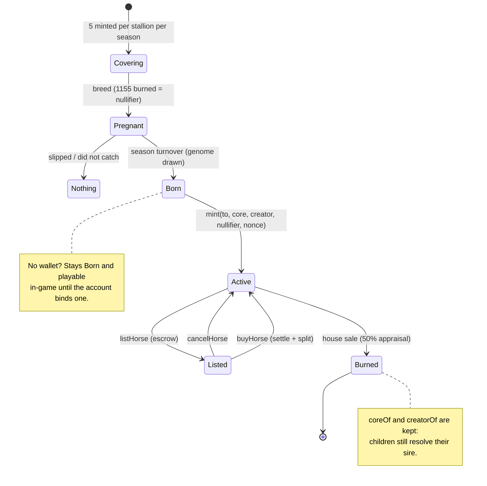
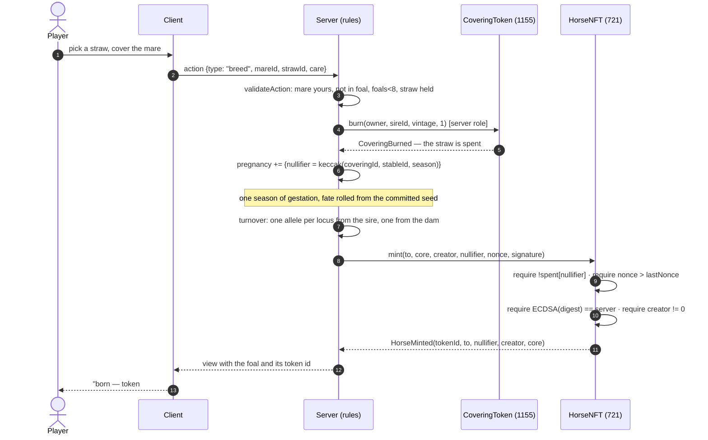
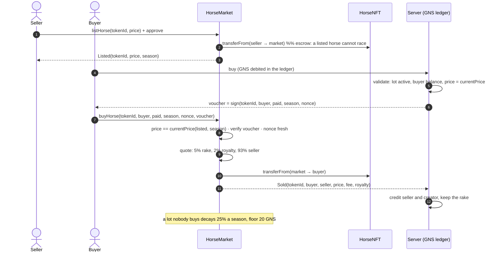
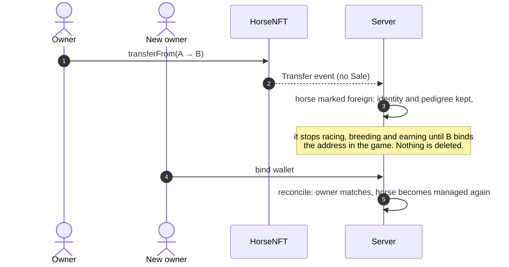
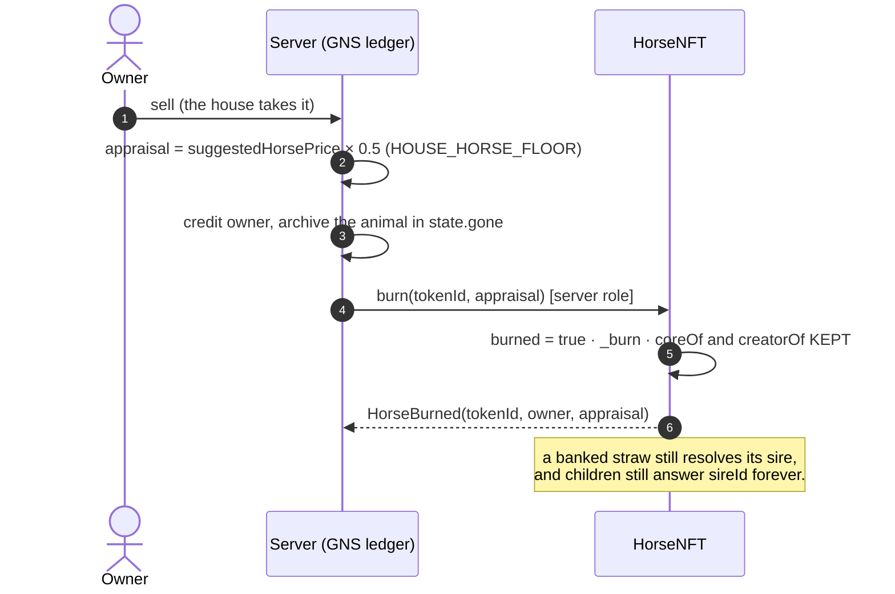

# NFT flow — mint, list, transfer, burn

The chain is a registry, not the game. The server owns the rules and signs every state change; the
token records what a horse **is** and who owns it movements. This document is the contract between
the two, written against the code that exists today (`assets/engine.js`, `server/index.mjs`).

---

## 0. The object

```
HorseNFT (ERC-721)
  uint64  genome       // 12 loci x 2 alleles x 2 bits = 48 bits
  uint8   lineage      // 1..8
  uint8   sex          // 0 mare, 1 stallion
  uint16  bornSeason
  uint32  sireId       // 0 = founder
  uint32  damId        // 0 = founder
  address creator      // the stable that bred it — royalties go here
  uint16  rulesVersion // the phenotype formula it was born under
  bool    burned

CoveringToken (ERC-1155)
  id = (sireId << 8) | vintageSeason      // one series per stallion per season
  supply = 5 per season, minted to the stallion's owner
```

Genome layout: `bit = locusIndex * 4 + alleleIndex * 2`, allele `0..3`. Loci are
`trait0, trait1` for each of speed, stamina, accel, recovery, temperament, soundness.

**Derived, never stored:** traits, note per going, `value`, `stakes`, inbreeding `F`, upkeep. Every
one of those depends on the living population (`F` is measured against it), so they live in the
server's view. On-chain is what the animal is; off-chain is what it is worth now.

---

## 1. State machine



`RETIRED` is a flag, not a state: a retired horse still exists, still costs board, and can still be
bred around (a straw outlives its sire). Only the house takes it out of the world.

---

## 2. Mint, from a consumed covering

**Why a nullifier and not a flag on the horse:** the thing that must be spent exactly once is the
*covering*, not the foal. The covering is the scarce object; the foal is what it buys.

### 2.1 Covering consumed (in-game action `breed`)

1. `validateAction` checks: mare owned, mare not in foal, `foals < 8`, age ≤ 12, straw held, guineas
   ≥ care cost. (Exists today.)
2. The straw leaves the barn. On-chain this is an **ERC-1155 burn**, signed by the server:
   `CoveringToken.burn(coveringId, 1, signature)`.
3. The pregnancy row stores `coveringId` — that is the nullifier:

```
nullifier = keccak256(coveringId, stableId, season)
```

4. The conception roll is committed: `roll = HMAC(seasonSeed, season, counter, "conceive")`, so a
   player can later prove whether the covering took.

### 2.2 Birth (season turnover)

The engine already builds the genome by copying **one allele per locus from each parent**
(`genome[locus] = [sire.genome[locus][rollInt(2)], mare.genome[locus][rollInt(2)]]`), assigns
lineage, sex, vigour (cross-lineage only), fate penalty and care bonus. Nothing changes here — the
birth is a receipt:

```
BirthReceipt {
  nullifier, coveringId, sireId, damId, bornSeason,
  genome (uint64), lineage, sex,
  seedReveal, alleleDraws[24],      // proof of which allele came from where
  rulesVersion
}
```

### 2.3 Mint transaction

```
mint(to, packed, nullifier, nonce, signature)
  require(msg.sender == minter)                       // game server, one role
  require(!spent[nullifier])                          // ← the nullifier
  require(allelesValid(genome))                       // every allele ≤ 3
  require(nonce > lastNonce[to] ...)                  // ordered, replay-proof
  spent[nullifier] = true
  tokenId = ++nextId
  records[tokenId] = packed; ownerOf = to
  emit HorseMinted(tokenId, to, nullifier, creator, rulesVersion)
```

Properties that matter:

- **Idempotent by construction.** A retried transaction reverts on `spent[nullifier]`; the server
  retries with the same nonce and wins nothing twice.
- **Only the server mints.** A player cannot mint a horse they did not breed, and cannot mint twice.
- **No wallet, no token — but the horse still exists.** If the account has no bound address, the
  horse stays `BORN (unminted)` and can be raced, bred and sold *inside* the game; it simply cannot
  be withdrawn or listed for real value. A `claim` window (12 months) mints to the address the
  account later binds. This is deliberate: forcing a wallet at signup loses half the players.

---

## 3. Listing and sale

The game already treats a listed horse as gone from the yard (`listHorse` sets `owner = null` and
drops it from `stable.horses`), so it cannot race, breed or be entered. **The token should mirror
that: listing is escrow.** Approval-based listing was rejected precisely because the game's own
semantics disagree with it.

```
list(tokenId, priceGns, season)
  escrow: ownerOf → market
  listedAt = season; price = priceGns
  emit Listed(tokenId, price, season)

currentPrice(tokenId, nowSeason):
  p = price
  for (s = listedAt; s < nowSeason; s++) p = p * 75 / 100      // DUTCH_DECAY = 0.75
  return max(p, 20)                                            // DUTCH_FLOOR = 20

cancel(tokenId)        → back to seller, no fee
buy(tokenId, buyer)    → settle at currentPrice
```

Decay is computed by the contract, not signed by the server — the rule already exists in the game
and costs the chain nothing to repeat.

### 3.1 Who gets what

Sale price splits in one transaction:

| Destination | Share | Why |
|---|---|---|
| seller | 93% | |
| treasury | 5% | `MARKET_RAKE`, the same number the in-game market charges |
| creator | 2% | breeding is the core verb; the person who produced the horse keeps earning on it |

Rounding: floor each share, the remainder goes to the seller, so the parts always sum exactly.

The creator is the stable that **owned the mare at birth** — that is where the work happened. If the
creator address is the zero address (an unclaimed account) the royalty goes to the treasury and the
event says so, rather than being held in limbo.

### 3.2 Buying

The currency question is the one to decide before writing code:

| Option | Consequence |
|---|---|
| **Price in GNS** (recommended for launch) | the in-game economy stays the economy; the NFT is the receipt. GNS enters through the door (fiat/crypto purchase), not through horse sales |
| Price in ETH/USDC | the market becomes an asset market and the game's own money becomes decorative — and every sale is a taxable, priced event |

Recommendation is GNS: the game already has a closed economy that measures clean (money drift
−1.2 GNS/season), and turning horses into a second currency would break the measurement that
makes it stable.

---

## 4. Transfers outside the market

`transferFrom` cannot be forbidden on an ERC-721 without making it a permissioned token. So it is
allowed, and the server reconciles:

- the server watches `Transfer` events; if a horse leaves the market without a `Sale`, the horse is
  marked **foreign** in the game: it keeps its identity, pedigree and history, but stops earning,
  racing and breeding until the new owner binds the address in the game.
- no horse is deleted, no pedigree is orphaned. The archive already solves the same problem for
  burned sires; this reuses it.

---

## 5. Burn

Exactly one path in the game removes a horse: the house sale (`sell`, and the forced sale when a
stable cannot pay upkeep). It pays **half the appraisal** and takes the animal.

```
burn(tokenId, signature)
  require(msg.sender == minter)
  pay 50% of appraisal in GNS to owner          // HOUSE_HORSE_FLOOR
  burned[tokenId] = true; ownerOf = 0x0
  keep records[tokenId]                          // ← pedigree survives
  emit HorseBurned(tokenId, price)
```

**Never delete the record.** A straw is valid after its sire retires, and children keep `sireId`
pointing at him forever: the contract must still answer `genomeOf(burnedId)` for pedigree display
and for `f`. Burning removes ownership and supply, not history.

The engine already does the off-chain half: `burnHorse` moves the animal to `state.gone` with its
genome intact, and a straw still prices from it.

---

## 6. Covering economics

| Moment | Money | Token |
|---|---|---|
| Season turnover | — | 5 coverings minted per stallion to his owner |
| Covering sold on the market | 5% rake → treasury, 95% → seller | 1155 transfers |
| Covering used to breed | care cost only | 1155 **burned** (the nullifier) |
| Unsold, barn over 22 | — | moved to market at floor, then culled → burned |

So the rake is charged on the **flow** (selling a covering), not on the use. That is the same split
the in-game market does today, which is why the straw market already produces a measurable rake.

---

## 7. Fairness and proof

Every roll that decides money is committed before it is taken and revealed after:

- season seed: `commit = H(seed)` published at season open, `seed` revealed at close;
- each draw: `HMAC(seed, season, meeting, counter, context)`;
- the birth receipt carries `seedReveal` and the 24 `alleleDraws`, so anyone can recompute which
  allele came from the sire and which from the dam, and check the genome on-chain matches.

That single property is the reason to put this game on a chain at all: **a result anyone can
recompute**. Everything else here could be a database.

---

## 8. Failure modes

| Case | Behaviour |
|---|---|
| Birth tx fails (gas, RPC) | server retries with the same nullifier + nonce; contract reverts until it lands exactly once |
| Player sells the mare while pregnant | the foal belongs to the breeder recorded on the pregnancy row (`stableId`), not to the mare's new owner; mint goes to the breeder |
| Sire burned before birth | genome already fixed at birth; mint reads `records[sireId]` |
| Account has no wallet | horse stays unminted, playable in-game, claimable for 12 months |
| Horse sold mid-season | entries cleared, race record travels with the token, new owner inherits it |
| Owner transfers outside the market | horse marked foreign until the new address binds; nothing is deleted |
| Creator wallet lost | royalty pays to treasury, event states it — never held in a contract that cannot release |
| Two servers sign the same horse | nonce is per-minter and monotonic; a second deployment cannot mint |

---

## 9. What exists, what is missing

| Piece | Status |
|---|---|
| Genome in 48 bits, one allele per parent | **exists** (`engine.js`, packing to be added) |
| Covering consumed on breed | **exists** (`stable.straws` splice) — needs the 1155 burn call |
| Burn on house sale with pedigree archive | **exists** (`burnHorse`, `state.gone`) |
| Listed horse leaves the yard (escrow semantics) | **exists** (`listHorse`) |
| Dutch decay with floor | **exists** (`DUTCH_DECAY`, `DUTCH_FLOOR`) |
| Rake 5% | **exists** (`MARKET_RAKE`) |
| Wallet binding, nullifier table, signatures | **to build** (server) |
| `HorseNFT` + `CoveringToken` | **to build** (contracts) |
| `rulesVersion` on the token | **to build** |

---

## 10. Three decisions before code

1. **Currency of the market**: GNS (recommended) or ETH/USDC.
2. **Royalty split**: 2% to the dam's owner at birth (recommended), or shared with the sire's owner.
3. **Unclaimed horses**: playable off-chain with a 12-month claim window (recommended), or
   mint-at-signup (forces a wallet on every player).

---

## 10. Sequence diagrams

### 10.1 Mint, from a covering the game has already burned



### 10.2 Listing and sale



### 10.3 Transfer outside the market



### 10.4 Burn


